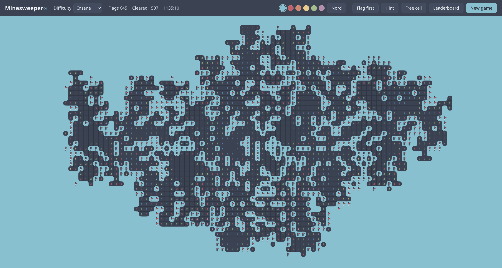

# Minesweeper∞

**Infinite-board minesweeper that never asks you to guess.**

An endless minesweeper board generated lazily and deterministically from a
seed, verified by a constraint solver after every reveal: a logical next
move always exists, and when one genuinely cannot, the board says so and
marks the zone instead of guessing for you. Modern flat design, one-click
chording, six difficulty tiers up to a brutal 40% mine density, synthesized
sound, theming, and a local leaderboard.



## Features

- **Infinite board** - the grid extends without limit in every direction;
  mine placement is a pure hash function of seed and coordinates, so
  nothing is stored until you explore it
- **No guessing** - after every reveal the solver verifies that a certain
  move exists and that no enclosed pocket of hidden cells is
  unresolvable; terrain that would dead-end is re-rolled, and the rare
  positions no re-roll can rescue are marked as guess zones instead of
  hidden or resolved by force
- **Deterministic solving aids** - a Hint button (or `H`) highlights a
  cell that is provably safe right now, and a Free cell button (or `F`)
  opens one guaranteed-safe cell of a marked guess zone, so a run never
  has to end in a guess
- **Fast controls** - click a satisfied number to chord (auto-disclose
  neighbors), click a number whose remaining unknowns are all mines to
  auto-fill flags; drag to pan, wheel to zoom
- **Six difficulties** - from Easy to Insane (see table below)
- **Local leaderboard** - biggest run (tiles cleared) and fastest time to
  200 tiles, per difficulty, stored in your browser
- **First click is always safe** - every game opens with a safe area
- **Theming** - two palettes (Nord and warm charcoal) plus six accent
  colors, switchable in-game and persisted per browser; the board, HUD and
  buttons all follow the accent
- **Sound** - WebAudio-synthesized feedback with no audio files: flags
  click, reveals crunch (deeper as the flood grows), a loss rings out
- **Flag-first mode** - a HUD toggle swaps short-click/right-click (and
  tap/long-press) between flag and open; numbers always chord
- **Mobile-ready** - one-finger drag pans, two-finger pinch zooms, a short
  tap acts, a long press flags; all animation yields to
  `prefers-reduced-motion`
- **Loss review** - a taunting end screen, then an Inspect board button
  that leaves the final board pannable and zoomable with wrong flags
  crossed out

## Controls

| Action            | Control                              |
| ----------------- | ------------------------------------ |
| Reveal a cell     | Left click                           |
| Flag / unflag     | Right click                          |
| Chord / auto-fill | Left click on a revealed number      |
| Swap flag/open    | Flag first toggle (top bar)          |
| Hint              | `H` or the Hint button               |
| Free cell         | `F` or the Free cell button          |
| Pan               | Drag, or arrow keys                  |
| Zoom              | Mouse wheel, or pinch                |
| New game          | `N` or the New game button           |
| Difficulty        | Dropdown in the top bar              |
| Leaderboard       | Leaderboard button                   |
| Theme / accent    | Nord/Charcoal button and accent dots |
| Inspect board     | Button on the end screen             |

## Difficulties

| Tier   | Mine density | Notes                                         |
| ------ | ------------ | --------------------------------------------- |
| Easy   | 12%          | matches the classic Beginner board (12.3%)    |
| Medium | 20%          | past classic Intermediate (15.6%)             |
| Hard   | 25%          | past classic Expert (20.6%)                   |
| Expert | 30%          | every frontier needs subset logic             |
| Evil   | 35%          | deep deduction; re-rolls get expensive        |
| Insane | 40%          | dense mine walls; the generator works hardest |

Density is the settled mine fraction of generated terrain, not a nominal
parameter - the calibration compensates for the per-chunk quota floor, so
the board you play lands on the percentage in the table. The classic
reference ladder (Beginner 9×9/10 = 12.3%, Intermediate 16×16/40 = 15.6%,
Expert 30×16/99 = 20.6%) is the community standard; the tiers past Expert
are our own calibration - past that point no universal standard exists,
only custom boards and "evil" no-guess modes like minesweeper.online's
(see References).

## How the no-guess engine works

1. A cell's mine status is a hash of `(seed, chunk nonce, x, y)` - the
   infinite board is fully defined yet stored nowhere.
2. Every 16×16 chunk draws its own mine quota around the difficulty
   density: `density * (1 + spread)` with a peaked spread
   (`spread = sign(u) * u^2` for uniform `u` in [-1, 1]), clamped from
   below at a fraction of the density. Easy, Medium and Hard use the
   density itself, because those tiers never stalled and their cascades are
   expensive; Expert and Evil floor at 80%, Insane at 85%. A uniform
   frontier at Insane density is ambiguous within a handful of moves, so
   the spread lets most chunks sit near the nominal density - the
   difficulty reads uniform - while rare chunks swing far enough to anchor
   a long deterministic chain, and the floor leaves no empty islands to
   walk through. The calibration compensates for the floor, so the settled
   mine fraction still lands on the table above.
3. Chunks become **committed** (nonce frozen) once they are visible to the
   player; before commitment the generator may re-roll them invisibly. A
   chunk's quota freezes with its first visible number, so no settled
   region ever changes density; only the opening reveal searches over the
   quotas of its still-unrevealed chunks, and whatever it picks is frozen
   the moment the numbers are shown.
4. Every reveal plays out tentatively. The first attempt is the honest
   outcome - an explosion there ends the run. Later attempts re-roll the
   freshly committed chunks inside a per-tier budget (50 ms on Easy up to
   900 ms on Insane) and keep the candidate whose deterministic chain runs
   deepest instead of the first acceptable one; the opening reveal also
   requires a playout 25 to 60 moves deep, scaled by density, so every
   game starts on terrain that stays solvable well past the first moves.
   Generation can take up to about a second on Insane, so a "Generating
   board..." indicator paints first and the run clock stops while it runs.
5. A candidate is accepted only when the position it produces holds at
   least one provably safe cell and every enclosed pocket of hidden cells
   the reveal created is fully deducible. If either check fails, the
   freshly committed chunks re-roll.
6. When re-rolling cannot repair ambiguity that already-committed terrain
   created, the honest layout stands and the ambiguous cells are
   **marked**: the HUD shows "Guess zone: N cells", those cells carry a
   dot on the sheet. You then have two honest options - open one Free
   cell (a real cell of the fixed layout that the board knows is not a
   mine) or take your chances guessing. The board never guesses for you
   and never opens cells you did not click.
7. Hint runs the same solver and highlights its next certain move.

The solver propagates per-cell mine bounds (lower and upper) across the
whole frontier until they stop tightening, then enumerates small
unresolved components exactly - so beyond the basic rules it also proves
cells safe that single-point and subset reasoning alone cannot reach.

## Build and run

Everything runs through nix; the site itself has zero runtime
dependencies (plain TypeScript compiled by `tsc`, native ES modules).

```sh
nix develop                           # dev shell
nix build .#site                      # static site in ./result
just serve                            # build + serve on http://localhost:8080
nix develop -c bash -c 'npm ci && npm test'   # unit tests (vitest)
nix flake check                       # full gate: build + pre-commit hooks
```

Pushing to `main` deploys to GitHub Pages via CI (enable "GitHub Pages via
GitHub Actions" once in the repository settings).

## References

- Simon Tatham's no-guess Mines - the classic perturbation-based
  generator/solver: https://www.chiark.greenend.org.uk/~sgtatham/puzzles/js/mines.html
- Minesweeper Online - no-guess mode and the Evil tier:
  https://minesweeper.online/help/gameplay
- Difficulty ladder reference: https://minesweeperblast.com/minesweeper-difficulty-levels/
- Approaches to creating solvable Minesweeper instances (CSP-based
  solver and generator study):
  https://doc.neuro.tu-berlin.de/bachelor/2024-BA-BenediktKunz.pdf
- Algorithms for Minesweeper Game Grid Generation:
  https://minesweepergame.com/math/algorithms-for-minesweeper-game-grid-generation-2017.pdf

## Who built this

This project was designed and implemented by **opencode**, an AI coding
agent (model: GLM, trained by z.ai), working under human direction and
review - including the game engine, solver, generator, UI, tests, nix
packaging, and this README.

**Disclaimer:** this is AI-generated code. It ships with a test suite and
CI, and the game engine is deterministic, but like any AI-written software
it may contain bugs or design choices a human author might have made
differently. Review before depending on it for anything serious. It is a
game; the stakes are your spare time.

## License

EUPL-1.2
